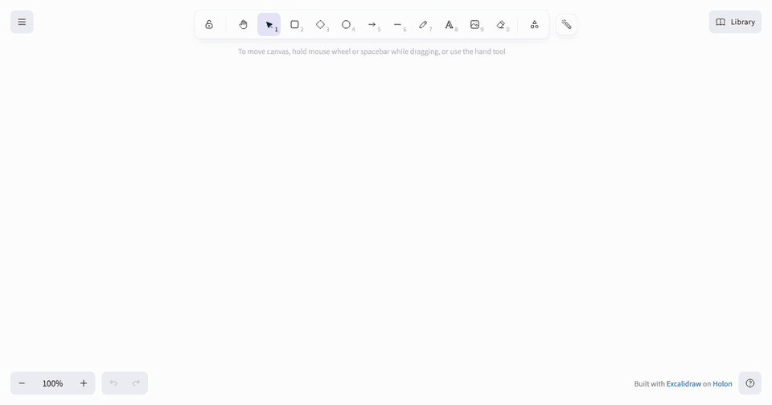
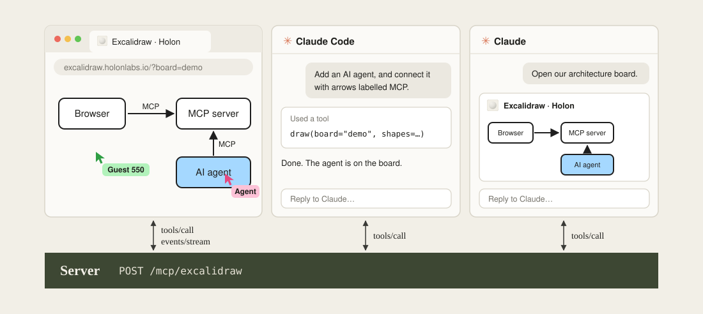

# Excalidraw

[excalidraw.holonlabs.io](https://excalidraw.holonlabs.io) hosts an [Excalidraw](https://github.com/excalidraw/excalidraw) server entirely over MCP on [Holon](https://holonlabs.ai). Point any agent to it and collaborate with them in real-time.



The page and agents share one MCP server. The page edits with the same `tools/call` an agent uses, and hears everyone else's edits through [MCP Events](https://github.com/modelcontextprotocol/experimental-ext-triggers-events/blob/main/docs/design-sketch-proposal.md).



## Self-host

```sh
npm ci && npm run build
npm run serve
```

The page is at `http://127.0.0.1:3000/` and the MCP endpoint at `http://127.0.0.1:3000/mcp/excalidraw`. Or run the image:

```sh
docker run -p 3000:3000 ghcr.io/holon-sh/excalidraw
```
