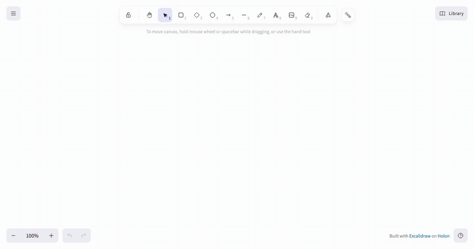
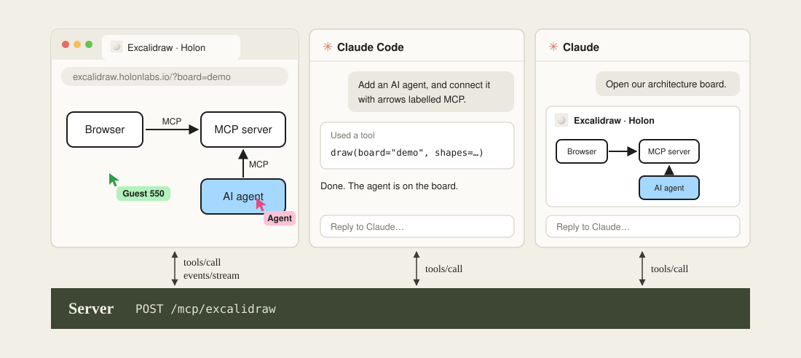

# Excalidraw

[excalidraw.holonlabs.io](https://excalidraw.holonlabs.io) hosts an [Excalidraw](https://github.com/excalidraw/excalidraw) server entirely over MCP on [Holon](https://holonlabs.ai). Point any agent to it and collaborate with them in real-time.



The page and agents share one MCP server. The page edits with the same `tools/call` an agent uses, and hears everyone else's edits through [MCP Events](https://github.com/modelcontextprotocol/experimental-ext-triggers-events/blob/main/docs/design-sketch-proposal.md).



## Board chat

On the Holon demo, select **Chat** on a board to open its shared conversation.
Guests can read it. Sign in to post or mention `@agent`, and choose
**Show on board** to focus the shapes the agent edited.
You can ask the agent again as soon as its current turn ends.

The browser connects to the separate Chat MCP app on the same installation.
Chat and Agent MCP own the transcript and Claude turns respectively.

In the drawing API, arrows connect two shape IDs with `from` and `to`.
The board calculates the arrow's geometry from those shapes.

## Self-host

```sh
npm ci && npm run build
npm run serve
```

The page is at `http://127.0.0.1:3000/` and the MCP endpoint at `http://127.0.0.1:3000/mcp/excalidraw`. Or run the image:

```sh
docker run -p 3000:3000 holonlabs/excalidraw
```
